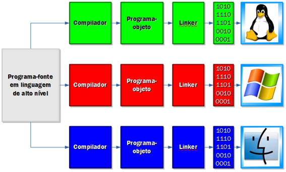

# Maratona Java ☕

Olá, eu sou **Luis Henrique**. Este repositório guarda os meus arquivos de estudo sobre a linguagem **Java**.

Como material de estudo estou usando a playlist do YouTube **"Maratona Java Virado no Jiraya"**, do canal **DevDojo**.

> ⚠️ Projeto em andamento. Este README é atualizado conforme eu avanço nas aulas.


---

## 📑 Sumário

1. [Como funciona a compilação do Java](#1-como-funciona-a-compilação-do-java)
2. [Introdução](#2-introdução)
3. [Java Core](#3-java-core)
4. [Xcollections (onde estou)](#4-xcollections-onde-estou)
5. [Progresso](#5-progresso)
6. [Como rodar os exemplos](#6-como-rodar-os-exemplos)

---

## Estrutura do projeto

```
src/academy/devdojo/maratonajava/
├── introducao/          # Aulas 01 a 08 (fundamentos da linguagem)
└── javacore/
    ├── Aintroducaoclasses/
    ├── Bintroducaometodos/
    ├── ...
    └── Xcollections/
        ├── domain/      # classes de modelo (Filme, Pessoa, Smartphone)
        └── test/        # classes com main() para testar cada conceito
```

Cada tópico do `javacore` segue o mesmo padrão: uma pasta `dominio` (ou `domain`) com as classes e uma pasta `test` com as classes que têm o método `main` para executar os exemplos. As pastas são prefixadas por letras (A, B, C...) para manter a ordem em que as aulas foram estudadas.

---

## 1. Como funciona a compilação do Java



A imagem acima mostra o processo **tradicional** de compilação de linguagens como C/C++: o código-fonte passa pelo **compilador**, gera um **programa-objeto**, passa pelo **linker** e vira **código de máquina específico** de cada sistema operacional (Linux, Windows, macOS). Ou seja, é preciso compilar uma vez para cada plataforma.

O Java segue um caminho diferente, pensado para ser **portável** ("escreva uma vez, rode em qualquer lugar"):

```
Código-fonte (.java)  →  javac  →  Bytecode (.class)  →  JVM  →  Execução (Linux / Windows / macOS)
```

1. Eu escrevo o código em um arquivo `.java`.
2. O compilador **`javac`** converte o código em **bytecode**, gerando arquivos `.class`. O bytecode **não** é específico de nenhum sistema operacional.
3. A **JVM** (*Java Virtual Machine*) lê o bytecode e o executa na máquina. Existe uma JVM para cada sistema operacional, e é ela que faz a "tradução" final para aquela plataforma.

### Compilando e executando pelo terminal

```bash
# compila (-d define a pasta onde os .class serão gerados)
javac -d out/production/maratona-java src/academy/devdojo/maratonajava/introducao/Aula01OlaDevDojo.java

# executa (precisa do nome completo da classe, com o pacote)
java -cp out/production/maratona-java academy.devdojo.maratonajava.introducao.Aula01OlaDevDojo
```

No dia a dia uso o IntelliJ IDEA, que faz esses dois passos por baixo dos panos. Os `.class` gerados ficam na pasta `out/production/maratona-java`.

---

## 2. Introdução

Pacote: `academy.devdojo.maratonajava.introducao`

| Aula | Assunto |
|------|---------|
| 01 | Primeiro programa, `main` e comentários (linha, bloco e Javadoc) |
| 02 | Tipos primitivos e casting |
| 03 | Exercícios de tipos primitivos |
| 04 | Operadores |
| 05 | Estruturas condicionais (`if`, `else if`, `switch`) |
| 06 | Estruturas de repetição (`while`, `do-while`, `for`) |
| 07 | Arrays |
| 08 | Arrays multidimensionais |

### Aula 01: Olá, DevDojo

```java
public class Aula01OlaDevDojo {
    public static void main(String[] args) {
        System.out.println("KA-ME-HA-HAAA!");
    }
}
```

### Aula 02: Tipos primitivos e casting

Os 8 tipos primitivos: `int`, `double`, `float`, `char`, `byte`, `short`, `long` e `boolean`. `String` **não** é primitivo.

```java
double wageDouble = 2000.0;
float wageFloat = (float) 2500.0D;
char caractere = 65;      // tabela ASCII/Unicode -> 'A'
char secCaractere = 'M';

// Casting explícito: perde a parte decimal
double mySecDouble = 9.78d;
int mySecInt = (int) mySecDouble;   // 9

// Casting implícito: int cabe em double
int myInt = 9;
double myDouble = myInt;            // 9.0
```

### Aula 04: Operadores

Aritméticos, resto (`%`), comparação, lógicos (`&&`, `||`, `!`), atribuição (`+=`, `-=`...) e incremento/decremento.

```java
int num1 = 10;
int num2 = 20;
double result = num1 / (double) num2;  // 0.5
double secResult = num1 / num2;        // 0.0 -> divisão entre dois int resulta em int

int counter2 = 0;
System.out.println(counter2++); // primeiro EXECUTA, depois incrementa -> 0
System.out.println(++counter2); // primeiro INCREMENTA, depois executa -> 2
```

### Aula 05: Estruturas condicionais

```java
byte day = 3;

switch (day) {
    case 1:
    case 7:
        System.out.println("Weekend");
        break;
    case 2: case 3: case 4: case 5: case 6:
        System.out.println("Work day");
        break;
    default:
        System.out.println("Invalid number.");
        break;
}
```

### Aula 06: Estruturas de repetição

```java
int count = 0;
while (count < 10) {
    System.out.println(count);
    count++;
}

for (int i = 0; i < 10; i++) {
    System.out.println("For " + i);
}
```

### Aulas 07 e 08: Arrays

```java
int[] ages = new int[3];
ages[0] = 21;

int[] numeros = {1, 2, 3, 4, 5};
for (int num : numeros) {            // for-each
    System.out.println(num);
}

// Multidimensional
int[][] dias = new int[3][3];
dias[0][0] = 31;
for (int[] arrBase : dias) {
    for (int num : arrBase) {
        System.out.println(num);
    }
}
```

---

## 3. Java Core

Pacote: `academy.devdojo.maratonajava.javacore`

| Pasta | Assunto |
|-------|---------|
| `Aintroducaoclasses` | Introdução a classes, atributos e objetos |
| `Bintroducaometodos` | Métodos, retorno, parâmetros e varargs |
| `CsobrecargaMetodos` | Sobrecarga de métodos |
| `Dconstrutores` | Construtores e `this()` |
| `Eblocosinicializacao` | Blocos de inicialização |
| `Fmodificadoresestaticos` | Modificador `static` |
| `Gassosiacao` | Associação entre classes |
| `Hheranca` | Herança, `super` e ordem de inicialização |
| `Isobreescrita` | Sobrescrita de métodos (`toString`) |
| `Jmodificadorfinal` | Modificador `final` |
| `Kenum` | Enumerações |
| `Lclassesabstratas` | Classes abstratas |
| `Minterfaces` | Interfaces |
| `Npolimorfismo` | Polimorfismo |
| `Oexception` | Exceções (`Error`, `Exception`, `RuntimeException`) |
| `Pwrapper` | Classes wrapper |
| `Qstring` | `String`, `StringBuilder` e String Pool |
| `Rdatas` | Datas e horas (`java.time`) |
| `Sformatacao` | Formatação de datas e números, `Locale` |
| `Tresourcebundle` | Internacionalização com `ResourceBundle` |
| `Uregex` | Expressões regulares (`Pattern` e `Matcher`) |
| `Vio` | Entrada e saída de arquivos (`java.io`) |
| `Wnio` | `java.nio` (`Path`, `Files`) |
| `Xcollections` | Collections Framework ← **estou aqui** |

### A. Introdução a classes

```java
public class Estudante {
    public String nome = "Goku";
    public int idade;
    public char sexo;
}

// No teste:
Estudante estudante = new Estudante();
estudante.nome = "Luffy";
estudante.idade = 21;
```

### B. Métodos

Métodos com e sem retorno, parâmetros e **varargs** (`int...`).

```java
public double divideDoisNumeros(double num1, double num2) {
    if (num2 == 0) {
        return 0;
    }
    return num1 / num2;
}

public void somaVarArgs(int... numeros) {
    int soma = 0;
    for (int num : numeros) {
        soma += num;
    }
    System.out.println(soma);
}
```

### C. Sobrecarga de métodos

Mesmo nome de método, parâmetros diferentes:

```java
public void init(String nome, String tipo, int epsodios) {
    this.nome = nome;
    this.tipo = tipo;
    this.epsodios = epsodios;
}

public void init(String nome, String tipo, int epsodios, String genero) {
    this.init(nome, tipo, epsodios);   // reaproveita a sobrecarga anterior
    this.genero = genero;
}
```

### D. Construtores

```java
public Anime(String nome, String tipo, int epsodios, String genero) {
    this();                            // chama o construtor sem argumentos
    this.nome = nome;
    this.tipo = tipo;
    this.epsodios = epsodios;
    this.genero = genero;
}

public Anime(String nome, String tipo, int epsodios, String genero, String estudio) {
    this(nome, tipo, epsodios, genero); // encadeamento de construtores
    this.estudio = estudio;
}
```

### E. Blocos de inicialização

Executados **toda vez** que um objeto é criado, antes do construtor:

```java
{
    System.out.println("Dentro do bloco de inicialização");
    epsodios = new int[100];
    for (int i = 0; i < epsodios.length; i++) {
        epsodios[i] = i + 1;
    }
}
```

### F. Modificadores estáticos

Atributos e métodos `static` pertencem à **classe**, não ao objeto:

```java
public class Carro {
    public static double velocidadeLimite = 250;

    public static void setVelocidadeLimite(double velocidadeLimite) {
        Carro.velocidadeLimite = velocidadeLimite;
    }
}

Carro.velocidadeLimite = 300;   // vale para todos os carros
```

### G. Associação

Uma classe se relaciona com outra (`Jogador` ↔ `Time`, `Professor` ↔ `Seminario`):

```java
public class Jogador {
    private String nome;
    private Time time;      // Jogador "tem um" Time
    ...
}

public class Time {
    private String nome;
    private Jogador[] jogadores;  // Time "tem vários" Jogadores
    ...
}
```

Também fiz um exercício de **gerenciador de seminários** (`Aexercicioassosiacao`) ligando `Professor`, `Aluno`, `Local` e `Seminario`.

### H. Herança

Ordem de execução ao instanciar uma subclasse: bloco **estático** da superclasse → bloco estático da subclasse → blocos de inicialização e construtor da superclasse → blocos de inicialização e construtor da subclasse.

```java
public class Funcionario extends Pessoa {
    private double salario;

    public Funcionario(String nome) {
        super(nome);
    }

    @Override
    public void imprime() {
        super.imprime();
        System.out.println("Salário: " + this.salario);
    }
}
```

### I. Sobrescrita de métodos

```java
public class Anime {
    private String nome;

    @Override
    public String toString() {
        return "Anime{nome='" + nome + "'}";
    }
}

System.out.println(new Anime("Naruto")); // Anime{nome='Naruto'}
```

### J. Modificador `final`

```java
public static final double VELOCIDADE_LIMITE = 250;   // constante

public final void imprime() {   // método que NÃO pode ser sobrescrito
    System.out.println(this.nome);
}
```

### K. Enum

Enum simples, com atributos e com **método abstrato por constante**:

```java
public enum ClienteTipo {
    PESSOA_FISICA(1, "Pessoa Física"),
    PESSOA_JURIDICA(2, "Pessoa Jurídica");

    private final int codigoCliente;
    private final String nomeRelatorio;

    ClienteTipo(int codigoCliente, String nomeRelatorio) {
        this.codigoCliente = codigoCliente;
        this.nomeRelatorio = nomeRelatorio;
    }
}

public enum ClienteTipoPagamento {
    DÉBITO {
        @Override
        public double calcularDesconto(double valor) { return valor * 0.1; }
    },
    CRÉDITO {
        @Override
        public double calcularDesconto(double valor) { return valor * 0.05; }
    };

    public abstract double calcularDesconto(double valor);
}
```

### L. Classes abstratas

```java
public abstract class Funcionario extends Pessoa {
    protected String nome;
    protected double salario;

    public abstract void calculaBonus();   // cada subclasse implementa o seu
}

public class Gerente extends Funcionario {
    @Override
    public void calculaBonus() {
        this.salario += this.salario * 0.2;
    }
}
```

### M. Interfaces

Constantes, métodos abstratos, `default` e `static`. Uma classe pode implementar várias interfaces:

```java
public interface DataLoader {
    int MAX_DATA_SIZE = 10;        // constante por padrão

    void load();                   // público e abstrato por padrão

    default void checkPermission() {
        System.out.println("Checando permissões dos dados.");
    }
}

public class FileLoader implements DataLoader, DataRemover {
    @Override
    public void load() {
        System.out.println("Carregando dados de arquivos.");
    }
}
```

### N. Polimorfismo

Tratar objetos diferentes pelo mesmo tipo (`Produto`) e usar `instanceof` + cast quando precisa:

```java
public static void calcularImposto(Produto produto) {
    double imposto = produto.calcularImposto();   // cada produto calcula do seu jeito
    System.out.println("Imposto à ser pago: R$ " + imposto);
    if (produto instanceof Tomate) {
        System.out.println("Data de validade: " + ((Tomate) produto).getDataValidade());
    }
}

Produto tv = new Televisao("Samsung Oled 4k 50\"", 5500);
CalculadoraImposto.calcularImposto(tv);
```

### O. Exceções

Três grupos: `Error` (ex.: `StackOverflowError`), `Exception` (checked, o compilador obriga a tratar) e `RuntimeException` (unchecked). Também **exceção customizada** e **try-with-resources**:

```java
public class LoginInvalidoException extends Exception {
    public LoginInvalidoException(String message) {
        super(message);
    }
}

private static void logar() throws LoginInvalidoException {
    if (!usernameDB.equals(usernameDigitado) || !passwdDB.equals(passwdDigitado)) {
        throw new LoginInvalidoException("Usuário ou senha inválidos.");
    }
}

// try-with-resources: fecha os recursos automaticamente
try (Leitor1 leitor1 = new Leitor1();
     Leitor2 leitor2 = new Leitor2()) {
    ...
} catch (IOException e) {
    e.printStackTrace();
}
```

### P. Wrapper

```java
String numeroString = "2022";
int numeroFormatoInteiro = Integer.parseInt(numeroString);
int somaTeste = 15 + numeroFormatoInteiro;   // 2037
```

### Q. String

`String` é **imutável**. Para muitas concatenações, usar `StringBuilder`.

```java
String nome = "Luis";
String nome2 = "Luis";
String nome3 = new String("Luis");

System.out.println(nome == nome2);            // true  -> mesmo objeto no String Pool
System.out.println(nome2 == nome3);           // false -> new cria outro objeto
System.out.println(nome2 == nome3.intern());  // true

StringBuilder sb = new StringBuilder("Luis Henrique");
sb.append(" Âncores").append(" Paiva");
sb.reverse();
```

### R. Datas

`Date` e `Calendar` (antigos) e a API moderna `java.time`: `LocalDate`, `LocalDateTime`, `LocalTime`, `Instant`, `Period`, `Duration`, `ChronoUnit`, `TemporalAdjusters` e `ZoneId`.

```java
LocalDate date = LocalDate.of(2026, Month.JANUARY, 30);
LocalDate dataAgora = LocalDate.now();
LocalDate acrescentaDia = dataAgora.plusDays(4);

// Diferença entre datas
LocalDateTime aniversario = LocalDateTime.of(2005, Month.JULY, 12, 11, 0, 0);
System.out.println(ChronoUnit.DAYS.between(aniversario, LocalDateTime.now()));

// Próxima terça-feira
LocalDate proximaTerca = LocalDate.now().with(TemporalAdjusters.next(DayOfWeek.TUESDAY));
```

### S. Formatação

```java
DateTimeFormatter formatterBR = DateTimeFormatter.ofPattern("dd/MM/yyyy");
String formatBR = LocalDate.now().format(formatterBR);
LocalDate parseBR = LocalDate.parse("08/09/2026", formatterBR);

// NumberFormat com diferentes Locales
NumberFormat nf = NumberFormat.getInstance(Locale.ITALY);
nf.setMaximumFractionDigits(2);
System.out.println(nf.format(10_000.2130));
```

### T. ResourceBundle

Arquivos `messages.properties`, `messages_pt_BR.properties` e `messages_en_US.properties` em `src/`:

```java
ResourceBundle bundle = ResourceBundle.getBundle("messages", new Locale("pt", "BR"));
System.out.println(bundle.getString("hello"));         // Olá
System.out.println(bundle.getString("good.morning"));  // Bom dia
System.out.println(bundle.getString("hi"));            // chave só no messages.properties (padrão)
```

### U. Regex

```java
// Encontrar números hexadecimais
String regex = "0[xX]([0-9a-fA-F])+(\\s|$)";
String texto = "12 0x 0X 0xFFABC 0X10G 0x1";

Pattern pattern = Pattern.compile(regex);
Matcher matcher = pattern.matcher(texto);
while (matcher.find()) {
    System.out.println("Posição: " + matcher.start() + " | Caracter: " + matcher.group());
}
```

### V. IO (`java.io`)

`File`, `FileWriter`, `FileReader`, `BufferedWriter` e `BufferedReader`:

```java
// FileWriter com append (true) e try-with-resources
try (FileWriter fw = new FileWriter(file, true)) {
    fw.write("Testando FileWriter\n");
    fw.flush();
} catch (IOException e) {
    e.printStackTrace();
}

// Lendo linha a linha
try (FileReader fr = new FileReader(file);
     BufferedReader br = new BufferedReader(fr)) {
    String linha;
    while ((linha = br.readLine()) != null) {
        System.out.println(linha);
    }
}
```

### W. NIO (`java.nio`)

```java
Path folderPath = Paths.get("nio-folder-test");
if (Files.notExists(folderPath)) {
    Files.createDirectory(folderPath);
}

Path subfolderPath = Paths.get("nio-folder-test/subfolder/subfolder");
Files.createDirectories(subfolderPath);

Path source = Paths.get(subfolderPath.toString(), "file-test.txt");
Path target = Paths.get(source.getParent().toString(), "renamed-nio-file.text");
Files.copy(source, target, StandardCopyOption.REPLACE_EXISTING);
```

---

## 4. Xcollections (onde estou)

Pasta: `javacore/Xcollections` (classes de modelo em `domain/`, testes em `test/`).

### Classes de modelo

| Classe | Papel |
|--------|-------|
| `Filme` | `id`, `titulo`, `preco`, `quantidade`. Implementa `Comparable<Filme>`, `equals` e `hashCode` |
| `Smartphone` | `serialNumber` e `marca`. `equals`/`hashCode` baseados no número de série |
| `Pessoa` | `nome`, `idade` e `sexo` (usada nos testes de `Iterator`) |

### 4.1 `List` e `ArrayList`

`List` mantém a ordem de inserção e aceita elementos repetidos.

```java
List<String> nomes = new ArrayList<>();
nomes.add("Luis");
nomes.add("Henrique");

for (String nome : nomes) {                 // foreach
    System.out.println(nome);
}
for (int i = 0; i < nomes.size(); i++) {    // for padrão
    System.out.println(nomes.get(i));
}

List<String> veiculos = new ArrayList<>();
veiculos.addAll(carros);
veiculos.addAll(motos);
veiculos.remove(3);          // remove por índice
veiculos.remove("Camaro");   // remove por objeto (usa equals)
```

### 4.2 Array ↔ List

```java
// List -> Array
Integer[] listToArray = numeros.toArray(new Integer[0]);

// Array -> List
// Arrays.asList é "apoiada" no array e tem tamanho fixo (não aceita add/remove)
List<Integer> arrayToList = Arrays.asList(numerosArray);
arrayToList.set(0, 14);

// Para uma lista modificável, é preciso envolver em um ArrayList
List<Integer> numerosList = new ArrayList<>(Arrays.asList(numerosArray));
numerosList.add(15);
```

### 4.3 `equals()` e `hashCode()`

`==` compara **referências** (endereço em memória); `equals()` compara **conteúdo** (quando bem implementado).

```java
String nome  = "Luis Henrique";
String nome3 = new String("Luis Henrique");
System.out.println(nome == nome3);        // false -> objetos diferentes
System.out.println(nome.equals(nome3));   // true  -> mesmo conteúdo
```

Para as coleções funcionarem direito com objetos próprios, é preciso sobrescrever `equals()` e `hashCode()` seguindo o contrato (reflexivo, simétrico, transitivo, consistente e `equals(null)` sempre `false`):

```java
@Override
public boolean equals(Object obj) {
    if (obj == null) return false;
    if (this == obj) return true;
    if (this.getClass() != obj.getClass()) return false;

    Smartphone smartphone = (Smartphone) obj;
    return serialNumber != null && serialNumber.equals(smartphone.serialNumber);
}

@Override
public int hashCode() {
    return serialNumber == null ? 0 : this.serialNumber.hashCode();
}
```

Com isso, métodos como `contains()` e `indexOf()` da `List` funcionam por conteúdo, pois usam o `equals()` por baixo dos panos:

```java
Smartphone s5 = new Smartphone("333G", "Samsung");
System.out.println(smartphones.contains(s5));    // true
int index = smartphones.indexOf(s5);             // posição do smartphone "igual"
smartphones.add(2, s6);                          // insere na posição 2
```

### 4.4 Ordenação: `Comparable` e `Comparator`

`Collections.sort()` ordena listas de tipos que já têm ordem natural (`String`, `Double`...):

```java
Collections.sort(filmes);   // List<String> -> ordem alfabética
Collections.sort(precos);   // List<Double> -> ordem crescente
```

Para classes próprias, a ordem natural é definida com **`Comparable`**:

```java
public class Filme implements Comparable<Filme> {
    @Override
    public int compareTo(Filme outroFilme) {
        // negativo se this < outro | 0 se iguais | positivo se this > outro
        return this.titulo.compareTo(outroFilme.getTitulo());   // ordena por título
    }
}
```

Para ordenar de **outras formas** sem mexer na classe, usa-se um **`Comparator`**:

```java
class FilmesByIdComparator implements Comparator<Filme> {
    @Override
    public int compare(Filme filme1, Filme filme2) {
        return filme1.getId().compareTo(filme2.getId());
    }
}

filmes.sort(new FilmesByIdComparator());   // ordena por ID
```

### 4.5 `Collections.binarySearch()`

A lista **precisa estar ordenada** (com o mesmo critério usado na busca). Se o elemento existe, retorna o índice. Se não existe, retorna `-(ponto de inserção) - 1`.

```java
List<Integer> numeros = new ArrayList<>(List.of(9, 4, 0, 1, 5));
Collections.sort(numeros);                          // [0, 1, 4, 5, 9]

System.out.println(Collections.binarySearch(numeros, 0));   //  0
System.out.println(Collections.binarySearch(numeros, -1));  // -1 (inseriria no índice 0)
System.out.println(Collections.binarySearch(numeros, 7));   // -5 (inseriria no índice 4)

// Com Comparator
filmes.sort(filmesByIdComparator);
Collections.binarySearch(filmes, movieToSearch, filmesByIdComparator);
```

### 4.6 `Iterator`

Remover elementos dentro de um `for-each` lança `ConcurrentModificationException`. Alternativas:

```java
// ❌ NÃO FUNCIONA
for (Filme filme : filmes) {
    if (filme.getQuantidade() == 0) {
        filmes.remove(filme);
    }
}

// ✅ Com Iterator
Iterator<Filme> filmeIterator = filmes.iterator();
while (filmeIterator.hasNext()) {
    Filme nextFilme = filmeIterator.next();
    if (nextFilme.getQuantidade() == 0) {
        filmeIterator.remove();
    }
}

// ✅ Programação funcional
filmes.removeIf(filme -> filme.getQuantidade() == 0);
```

> O `Iterator` **não reseta** ao terminar de percorrer a lista. Para percorrer de novo, é preciso chamar `lista.iterator()` outra vez.

### 4.7 `Set`: `HashSet` e `LinkedHashSet`

`Set` **não permite elementos duplicados** (usa `equals()` e `hashCode()` para decidir).

| Implementação | Mantém ordem de inserção? |
|---------------|--------------------------|
| `HashSet` | ❌ Não |
| `LinkedHashSet` | ✅ Sim |

```java
Set<Filme> filmes = new LinkedHashSet<>();
filmes.add(new Filme(8L, "Platoon", 3.99, 2));
filmes.add(new Filme(8L, "Platoon", 3.99, 2));   // duplicado: não é adicionado
```

Aqui o `equals()` e o `hashCode()` de `Filme` (baseados em `id` e `titulo`) é que fazem o segundo "Platoon" ser reconhecido como repetido.

### 4.8 `NavigableSet` e `TreeSet`

`TreeSet` mantém os elementos **ordenados** e sem duplicatas. A ordem vem do `Comparable` do elemento ou de um `Comparator` passado no construtor.

```java
// Ordenando Smartphones por marca com Comparator
NavigableSet<Smartphone> set = new TreeSet<>(new SmartphoneMarcaComparator());

// Ordem natural (Comparable do Filme -> por título)
NavigableSet<Filme> filmes = new TreeSet<>();

// Métodos de navegação
NavigableSet<String> letras = new TreeSet<>();
letras.add("B"); letras.add("A"); letras.add("D"); letras.add("C"); letras.add("A");

System.out.println(letras);                  // [A, B, C, D]
System.out.println(letras.first());          // A
System.out.println(letras.last());           // D
System.out.println(letras.lower("C"));       // B  (maior elemento menor que "C")
System.out.println(letras.contains("D"));    // true
```

---

## 5. Progresso

- [x] Compilação do Java
- [x] Introdução (aulas 01 a 08)
- [x] A. Introdução a classes
- [x] B. Métodos
- [x] C. Sobrecarga de métodos
- [x] D. Construtores
- [x] E. Blocos de inicialização
- [x] F. Modificadores estáticos
- [x] G. Associação
- [x] H. Herança
- [x] I. Sobrescrita
- [x] J. Modificador `final`
- [x] K. Enum
- [x] L. Classes abstratas
- [x] M. Interfaces
- [x] N. Polimorfismo
- [x] O. Exceções
- [x] P. Wrapper
- [x] Q. String
- [x] R. Datas
- [x] S. Formatação
- [x] T. ResourceBundle
- [x] U. Regex
- [x] V. IO
- [x] W. NIO
- [ ] **X. Collections** (em andamento: `List`, `equals`/`hashCode`, `Comparable`/`Comparator`, `binarySearch`, `Iterator`, `Set` e `NavigableSet` já feitos)

> Os próximos tópicos serão adicionados aqui conforme eu avançar nas aulas.

---

## 6. Como rodar os exemplos

1. Clone o repositório:
   ```bash
   git clone git@github.com:luispaivaa/maratona-java.git
   ```
2. Abra a pasta no IntelliJ IDEA (ou outra IDE com JDK instalado).
3. Abra qualquer classe da pasta `test/` (ou da `introducao`) e execute o método `main`.

**Observações:**
- Alguns testes de IO e NIO (`Vio`, `Wnio`) usam **caminhos absolutos da minha máquina** (`/home/luispaiva/...`). Ajuste o caminho antes de executar.
- `HerancaTest01` e `LoginInvalidoExceptionTest01` esperam entrada pelo teclado (`Scanner`).

---

*Material de estudo: playlist "Maratona Java Virado no Jiraya", canal DevDojo.*